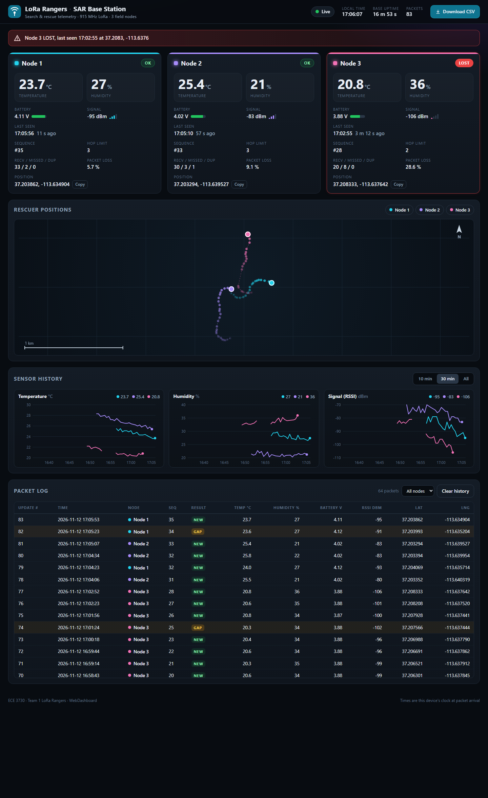

# Team Project: ECE3730_Team_1_LoRa Rangers

## Project Overview
A fun team project with a search-and-rescue connection

## Team Members
| Name | GitHub Username | Responsibility |
|------|-----------------|----------------|
| Moustafa Bendari | Moustafa-Bendari | Web dashboard (live display of node data) |

## Individual Contribution: Moustafa Bendari

### My Responsibility
I built the **WebDashboard**, the GUI that runs on the base station ESP32. The base station starts its own WiFi network (`LoRaRangers-Base`) and serves a dashboard at `http://192.168.4.1`. A team lead joins that network on a laptop or phone and watches every rescuer live. The page works fully offline: no internet, CDNs or external libraries.

The dashboard takes each packet that Braxton's decoder produces and:
- stamps it with the base station's time on arrival (node clocks are not shared)
- checks the sequence number to find **missed**, **duplicate** and **late (old)** packets, including the 65535 → 0 wrap and node restarts
- marks each node **OK**, **LATE** (no packet for 60 s) or **LOST** (150 s), since nodes send every ~30 s
- serves a web page with a LOST alert banner (with an optional sound alarm), one card per node (temperature, humidity, battery, signal, last seen, packet loss, GPS position, rescuer name), a position map with trails, temperature/humidity/RSSI charts, a packet log, a CSV download, and a bright "Sun mode" for reading outdoors

### My Files
The module is in `modules/WebDashboard/`:
- `WebDashboard.h` — The `WebDashboard` class, the `DashboardReading` struct, the `UpdateResult` / `NodeStatus` enums, and the settings (`DASH_LATE_MS`, `DASH_LOST_MS`, WiFi name...).
- `WebDashboard.cpp` — Sequence tracking, LATE/LOST status, the 64-packet history ring buffer, CSV parsing, JSON output, and the WiFi access point and web routes (`/`, `/data`).
- `WebDashboardPage.h` — The web page stored in flash (generated from `web/index.html` by `tools/embed_page.py`).
- `WebDashboardCodec.h` — `toDashboardReading()`, which turns the team's `DecodedPacket` into a dashboard reading in one call.
- `WebDashboardDemo.h` / `WebDashboard.ino` — Test sketch with demo modes: 3 simulated rescuers walking near Snow Canyon, Utah, with lost packets, a duplicate, and Node 3 dropping out (LATE → LOST → recovers).
- `web/index.html` — The page source (HTML, CSS and JavaScript in one file).
- `tools/preview_server.py` — Runs the page on a laptop with simulated data, or live from the base station's USB serial output (`--serial COM3`).
- `test/` — Host tests: C++ compiled with g++ against stub Arduino/WiFi/WebServer headers, and a Python test for the laptop live mode.
- `docs/dashboard.png` — Screenshot of the dashboard used in this report.

### My Inputs and Outputs
| Direction | Data | Type / Units / Format | Source or Destination |
|-----------|------|-----------------------|-----------------------|
| Input | Decoded packet | `DecodedPacket` → `DashboardReading`: node ID, seq #, elapsed ms, lat/lng (degrees), temperature (°C), humidity (%RH), hops, battery (mV), plus RSSI (dBm) | Braxton's `PacketCodec::decode()` on the base station, via `dashboard.update(toDashboardReading(pkt, rssi), millis())` |
| Input | CSV line (alternative) | Text: `[CSVDATA] node_id,seq,elapsed_ms,latitude,longitude,temp_c,humidity_pct,hops,battery_mv,rssi_dbm` (same order as `SerialForwarder`) | `dashboard.updateFromCsv(line, millis())`, the Serial Monitor, or the laptop over USB serial |
| Input | Arrival time | `millis()` of the base station (ms) | Base station clock |
| Output | Update result | `UpdateResult`: NEW, GAP, DUPLICATE, OLD, BAD_NODE | Calling code / Serial |
| Output | Node status | `NodeStatus`: NO_DATA, OK, LATE (≥ 60 s), LOST (≥ 150 s) | Web page, `getStatus()` |
| Output | Live dashboard | Web page at `http://192.168.4.1` (WiFi `LoRaRangers-Base`) | Team lead's browser (laptop or phone) |
| Output | JSON data | `GET /data?since=<id>`: node states + packets newer than `id` | The web page (polls every 1 s) |
| Output | Log line | Text CSV `DASH,received_at_ms,node_id,seq,result,...` | Serial Monitor or SD card |
| Output | CSV file | `update,timestamp,node,seq,result,lat,lng,temp_c,humidity_pct,battery_mv,rssi_dbm` | Download CSV button in the browser |

### My Test Plan
- **Host tests (no hardware):** compile the library with g++ and stub ESP32 headers, then feed it readings and CSV lines. Check the result of each, the counters, the node status at exact times, and the JSON output.
- **JSON validity:** every JSON response the tests produce is checked with `python -m json.tool`, including responses built in buffers that are deliberately too small.
- **Browser preview (no hardware):** run `tools/preview_server.py` and check every section of the page with simulated data, on a laptop-sized and a phone-sized screen.
- **ESP32 compile:** `arduino-cli compile` for the team's board (`esp32:esp32:esp32`) and the Heltec V3.
- **On hardware (next):** flash `WebDashboard.ino`, join `LoRaRangers-Base`, open `192.168.4.1`, then add the one `update()` line to the base station receive code and test with real packets.

### Test Results (November 12, 2026)
| Test | Result |
|------|--------|
| Valid CSV, with and without the `[CSVDATA]` prefix, negative temperature, `nan` sensor values | Pass |
| 20 malformed CSV lines (wrong field count, empty fields, junk, out-of-range lat/lng/humidity/seq/hops/battery/RSSI, too long, null) | Pass: all rejected, nothing stored |
| Node IDs 0 and 4 | Pass: rejected as `BAD_NODE` |
| Gap (seq 2 → 5) | Pass: `GAP`, 2 missed |
| Duplicate / old packet | Pass: ignored and counted; "last seen" not refreshed |
| Sequence wrap 65535 → 0 (and 65534 → 1) | Pass: `NEW` with 0 missed (and `GAP` with 2 missed) |
| Node reboot (seq 500 → 1, clock back to 2 s) | Pass: tracking reset, 0 missed |
| OK → LATE → LOST timing (59 999 / 60 000 / 149 999 / 150 000 ms) and `millis()` wrap | Pass |
| `buildJson` valid JSON, `since` filter, 64-packet ring buffer | Pass: all JSON files valid in `python -m json.tool` |
| Tiny buffers (0 to 3000 bytes) | Pass: no byte written past the buffer; paging delivers all 30 packets |
| Web routes `/`, `/data`, unknown path | Pass: 200 page, 200 JSON, 404 |
| Mode label, boot ID (base restart detection), `since` past the newest packet, buffer too small for one packet | Pass |
| **Total C++ host tests** | **212 checks passed, 0 failed** |
| Laptop live mode (Python): same good/bad CSV lines as the C++ parser, counters, `nan` sent as JSON `null`, CSV log format | Pass |
| Live mode end to end: `[CSVDATA]` lines over a simulated serial link shown on the page | Pass |
| ESP32 compile, `esp32:esp32:esp32` (core 3.3.12) | Pass: 983 115 bytes flash (75%), 68 128 bytes RAM (20%) |
| ESP32 compile, `heltec_wifi_lora_32_V3` | Pass: 939 624 bytes flash (28%), 66 736 bytes RAM (20%) |
| Browser: all 6 sections, LOST alert, refresh keeps history, phone layout, Sun mode, rescuer names | Pass |
| On real hardware with real packets | Not done yet |

---

# WebDashboard Library Documentation

| Information | Entry |
|---|---|
| **Student** | Moustafa Bendari |
| **Team** | Team 1, LoRa Rangers |
| **Module** | WebDashboard (base station web GUI) |
| **Date** | November 12, 2026 |
| **Repository link** | https://github.com/Cookiepie2256/ECE3730_Team_1_LoRa-Rangers |

## 1. Library Use and Interface

WebDashboard is the last step of the data chain: nodes send packets over LoRa, the base station decodes them with Braxton's `PacketCodec`, and WebDashboard stores them and shows them in a browser. It uses only the ESP32 Arduino core (`WiFi.h`, `WebServer.h`), so it runs on any ESP32 regardless of the LoRa chip.

Use it in this order: create one `WebDashboard` object, call `begin()` in `setup()`, call `handleClient()` every `loop()`, and call `update()` (or `updateFromCsv()`) each time a packet is decoded.

| Public function | Inputs | Returns or output | Purpose and use notes |
|---|---|---|---|
| `WebDashboard(uint16_t port = 80)` | Web server port | Dashboard object | Create one global object. |
| `begin(ssid, pass)` | WiFi name and password (default `LoRaRangers-Base` / `rangers123`) | `bool`: true if the access point started | Starts WiFi at `192.168.4.1` and registers `/` and `/data`. Call once in `setup()`. |
| `handleClient()` | None | None | Answers browser requests. Call every `loop()`. |
| `update(reading, nowMs)` | `DashboardReading`, `millis()` | `UpdateResult`: `NEW`, `GAP`, `DUPLICATE`, `OLD`, `BAD_NODE` | Main input. Stores the reading and classifies it by sequence number. |
| `updateFromCsv(line, nowMs, &result)` | One CSV line (`[CSVDATA] ` prefix optional), `millis()` | `bool`: false if malformed or the node ID is not 1–3 | Same as `update()` but for Braxton's `SerialForwarder` text line. |
| `toDashboardReading(pkt, rssi)` (`WebDashboardCodec.h`) | `DecodedPacket`, RSSI in dBm | `DashboardReading` | Converts the decoder's struct in one call. |
| `getStatus(nodeId, nowMs)` | Node ID 1–3, `millis()` | `NodeStatus`: `NO_DATA`, `OK`, `LATE`, `LOST` | Lets the base station react to a lost rescuer. |
| `setTimeouts(lateMs, lostMs)` | Milliseconds | None | Changes the 60 s / 150 s limits for a different send interval. |
| `setModeLabel(label)` | Text | None | Label shown in the page header (for example, the demo mode). |
| `getNode(nodeId)` | Node ID 1–3 | `const NodeState*` (last reading, arrival time, received / missed / duplicates) | `nullptr` for an invalid ID. |
| `buildJson(buf, len, nowMs, sinceId)` | Buffer, size, `millis()`, last update # seen | Bytes written | Builds the `/data` reply with only packets newer than `sinceId`. It never writes past the buffer. |
| `logLine(nodeId, buf, len)` | Node ID, buffer | Bytes written | One CSV line for Serial or an SD card. |

### Example of Use by Another Team Member

The base station receive loop with the dashboard added (this matches the comments in `WebDashboard.ino`). Run `just link-libs` once so `#include <PacketCodec.h>` resolves.

```cpp
#include <PacketCodec.h>
#include <SerialForwarder.h>
#include <RH_RF95.h>
#include "WebDashboard.h"
#include "WebDashboardCodec.h"

RH_RF95 radio(18, 26);
SerialForwarder forwarder(Serial);
WebDashboard dashboard;

void setup() {
    Serial.begin(115200);
    radio.init();
    radio.setFrequency(915.0);
    dashboard.begin(); // WiFi "LoRaRangers-Base" -> http://192.168.4.1
}

void loop() {
    dashboard.handleClient(); // serve the page

    uint8_t rx[PacketCodec::PACKET_SIZE];
    uint8_t len = sizeof(rx);
    if (radio.recv(rx, &len)) {
        DecodedPacket pkt;
        if (PacketCodec::decode(rx, len, pkt)) {
            int16_t rssi = radio.lastRssi();
            forwarder.forward(pkt, rssi);                              // PC CSV log
            dashboard.update(toDashboardReading(pkt, rssi), millis()); // web GUI
        }
    }
}
```

## 2. Testing and Results

The full test list and results are in **Test Results** above.

| Test item | Description |
|---|---|
| **Test setup** | Host tests: Windows PC, g++ (WinLibs) with stub `Arduino.h` / `WiFi.h` / `WebServer.h`, Python 3.12 for JSON checks and the live-mode test. Browser: `tools/preview_server.py` with 3 simulated nodes. ESP32: arduino-cli, ESP32 core 3.3.12, boards `esp32:esp32:esp32` and Heltec V3. |
| **Test procedure** | Run `test/run_tests.bat`. Run the preview and check every page section, including Node 3 going LATE then LOST and recovering, a page refresh, and a phone-sized window. Compile `WebDashboard.ino` for both boards. |
| **Expected result** | Every sequence, timing and JSON check passes; the page shows all 6 sections with live data; Node 3 turns LATE after 60 s and LOST after 150 s with a red alert; the sketch compiles for the ESP32. |
| **Observed result** | 212 C++ checks passed, 0 failed; all JSON output valid; Python live-mode tests passed. The preview showed all 6 sections, the LOST alert, GAP rows and history kept after a refresh. ESP32 build: 983,115 bytes flash (75%), 68,128 bytes RAM (20%). The embedded page is 39,656 bytes. Not yet run with real packets from the nodes. |


*The dashboard with simulated data from 3 nodes. Node 3 has been silent for over 150 s, so it shows LOST with a red alert and its last position. The map shows each rescuer's trail, the charts show temperature, humidity and RSSI, and the packet log highlights GAP rows where packets were missed. The ESP32 serves the same page at http://192.168.4.1.*

Test output (`test\run_tests.bat`):

```
ok: WebDashboardPage.h is current (39656 bytes)
[PASS] valid CSV
[PASS] malformed CSV
[PASS] node IDs 0 and 4
[PASS] gap
[PASS] duplicate
[PASS] old packet
[PASS] seq wrap 65535 -> 0
[PASS] node reboot
[PASS] OK -> LATE -> LOST timing
[PASS] buildJson valid JSON
[PASS] since filter
[PASS] ring buffer
[PASS] tiny buffers + paging
[PASS] mode label, boot id, edge cases
[PASS] logLine
[PASS] web routes

212 checks passed, 0 failed, 8 JSON files written
JSON check: every file is valid (python -m json.tool)
[PASS] test_parse
[PASS] test_feed_and_json
[PASS] test_demo_json_valid
live feed tests: all passed
All tests passed
```

## 3. Current Status and Integration Notes

| Item | Notes |
|---|---|
| **Working** | WiFi access point and web server; live page (node cards, LOST alert with sound, position map, charts, packet log, CSV download, rescuer names, Sun mode); arrival timestamps; GAP / DUPLICATE / OLD / reboot detection; LATE (60 s) and LOST (150 s) status; history kept across page refreshes; demo modes; Serial CSV input; laptop preview and live mode; host tests. |
| **Known issues** | Not yet tested with real packets from the nodes. Times are the viewing device's clock at packet arrival. The board keeps the last 64 packets; longer history is kept in the browser. |
| **Integration notes** | The CSV order matches Braxton's `SerialForwarder`: `node_id,seq,elapsed_ms,latitude,longitude,temp_c,humidity_pct,hops,battery_mv,rssi_dbm` (hops before battery; temperature and humidity are decimals). Integration is one line in the base station receive loop: `dashboard.update(toDashboardReading(pkt, rssi), millis());`. WiFi and LoRa run at the same time on the ESP32. |
| **Next step** | Add that line to the base station receive sketch with Braxton, then test with real packets from all three nodes. |
